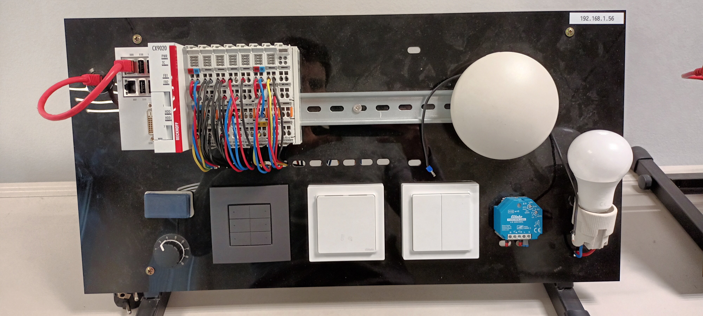

## The setup

EnOcean is a wireless communication protocol that allows low-power devices to communicate with each other without the need for batteries or wired connections. It is designed for use in energy-efficient buildings and smart homes, where sensors and control systems need to be able to communicate with each other wirelessly over long distances without consuming a lot of power.

EnOcean uses energy harvesting technology to power its devices. This means that the devices are able to capture energy from their environment, such as from light or motion, and use that energy to transmit data wirelessly. This eliminates the need for batteries or wired connections, making EnOcean devices easy to install and maintain.

EnOcean uses a unique data link layer protocol called "EnOcean Radio Protocol" (ERP) and uses a combination of frequency-shift keying (FSK) and amplitude-shift keying (ASK) modulation to transmit data. ERP is a packet-based protocol that consists of a synchronization byte, header, data field, and optional fields such as security and CRC.

> BeckHoff Application Film: [Building Automation in a Miele administration building](https://youtu.be/4wDrKjwuDCw?t=164)

> Beckhoff Application Film: [Beckhoff manages 60K data points in Tower 185 at Frankfurt, consisting of DaLI and EnOcean communication.](https://www.youtube.com/watch?v=8wU_nKmCpQ0)

## Hardware

- EnOcean devices:
  - Eltako F4T65-wg, vier druktoetsen + QR11Gs-sz kader
  - Eltako FFT65B-wg, temperatuur en luchtvochtigheid sensor
  - Eltako FUD61NPN, universele dimactor
- PLC terminal: 
  - KL6581 EnOcean 1-channel communication interface
  - KL6583 EnOcean radio transceiver

## Preperations

- Lees de [documentatie van de EnOcean druktoetsen](resources/F4T65_30065705-1.pdf)

- Lees de [documentatie van de EnOcean temperatuur en luchtvochtigheid sensor](resources/FFT65B_30065475-2.pdf)

- Lees de [documentatie van de EnOcean universele dimactor](https://www.eltako.com/nl/catalog/products/1410/fud61npn-230v)

  Raadpleeg de handleiding van de Beckhoff [KL6581 Master and KL6583 Transceiver](https://download.beckhoff.com/download/document/io/bus-terminals/kl6581_kl6583en.pdf). Lees zeker de pagina's:

  - Product overview => KL6581 - Introduction

  - Product overview => KL6581 - Technical data

  - Mounting and wiring => KL6581 - Contact assignment

  - Mounting and wiring => Cabling between KL6581 and KL6583

  - Programming => Operation with other controllers => Process image

- Lees volgende pagina's over de EnOcean bibliotheek [TC2_EnOcean](https://infosys.beckhoff.com/english.php?content=../content/1033/tcplclib_tc2_enocean/index.html&id=)

  - Introduction
  - EnOcean
  - Programming => POUs => KL6581 (zo goed als ieder item onder KL6581 POUs zal je kunnen gebruiken)
  - Programming => DUTs => KL6581 =>  Structures => KL6581_Input, KL6581_Output, STR_EnOceanSwitch en STR_KL6581
  - Programming => Integration into TwinCAT => KL6581 with CX5120 (as example)

## Goals

1.  Leg in je eigen woorden EnOcean uit. Hoe is het opgebouwd en wat kan je ermee?
2.  Beschrijf de aansluitingen van de KL6581.
3.  Beschrijf de 'FB_KL6581' functieblok. Welke zijn de in- en uitgangen en waarvoor wordt deze gebruikt?
4.  Beschrijf de 'KL6581_Input' structure. Wat is de inhoud en waarvoor wordt deze gebruikt?
5.  Beschrijf de 'KL6581_Output' structure. Wat is de inhoud en waarvoor wordt deze gebruikt?
6.  Hoe worden EnOcean toestellen gezocht en ingeleerd (begrippen zoals telegram, [EEP](https://www.enocean-alliance.org/products/eeps/), ORG id.)? Is inleren noodzakelijk?
7.  Beschrijf de aansluitingen en de werking van de EnOcean druktoetsen van Eltako.
8.  Beschrijf de aansluitingen en de werking van de EnOcean temp/hum sensor van Eltako.
9.  Beschrijf de aansluitingen en de werking van de EnOcean dimmer van Eltako.

## Exercises

Programmeer de PLC zodat EnOcean toestellen te besturen zijn en hun data zichtbaar getoond worden vanuit een visualisatie. Voor EnOcean te programmeren dien je de bibliotheek Tc2_EnOcean toe te voegen bij je References.

### Programmatie (minimaal vereist om 60% te behalen)

#### 1. Communicatie en EnOcean device scanning (15%)

Maak gebruik van de 'FB_KL6581' functieblok voor de communicatie met de KL6581. Koppel de juiste variabelen met de KL6581. **Voer een scan uit** om alle EnOcean devices te detecteren.

**Toon in visualisatie:**

- Alle gevonden EnOcean IDs (32-bit hexadecimaal)
- Hun EEP profiles (Equipment Profile, bv. F6-02-01)
- RSSI waarden (Received Signal Strength Indicator, signaalsterkte in dBm)
- Status van de scan (bezig/klaar, aantal gevonden devices)

> [!Tip]
> EnOcean devices zijn continue in een low-power mode. Ze ontwaken en sturen dus ALLEEN een telegram op periodieke wijze of bij een status-wijziging. Neem de documentatie door voor meer informatie.

#### 2. Temperatuur en vochtigheid sensor met statistieken (15%)

Lees de FFT65B sensor uit en toon in de visualisatie de **Relatieve vochtigheid (%)** met eenheid en de **Temperatuur (°C)** met eenheid. Log daarnaast ook enkele **Statistieken (sinds start van je programma):**

- Minimum temperatuur + timestamp wanneer deze gemeten werd
- Maximum temperatuur + timestamp wanneer deze gemeten werd
- Minimum vochtigheid + timestamp
- Maximum vochtigheid + timestamp
- Gemiddelde temperatuur over de laatste 10 metingen (moving average)
- Gemiddelde vochtigheid over de laatste 10 metingen (moving average)

**Functionaliteit:**

- Reset-knop in visualisatie om alle min/max waarden te resetten
- Aantal metingen teller (hoeveel keer is nieuwe data ontvangen)

> [!Tip]
>
> Voor timestamps gebruik je de PLC systeem tijd. Voor de moving average heb je de Tc2_BABasic library nodig.

#### 3. Druktoetsen voor light-control (15%)

Lees de F4T65 druktoetsen in en implementeer de volgende functionaliteit met een LED op de EL2008 terminal (gebruik FB_Light uit de Tc2_BABasic library):

- **Knop linksboven:** Toggle functie (aan/uit wisselen bij elke druk)
- **Knop rechtsboven:** Alles aan (100% brightness indien dimbaar)
- **Knop rechtsonder:** Alles uit (0%)

> [!Tip]
>
> EnOcean druktoetsen sturen meestal een "press" en "release" telegram. Zorg dat je logica hier correct mee omgaat (edge detection)!
> 

#### 4. Dimmer inleren via teach-in (15%)

Leer de knop linksonder in op de universele dimmer FUD61NPN zodat deze de dimmer rechtstreeks kan bedienen (zonder via de PLC te gaan).

**Stappen:**

1. Zet de FUD61NPN dimmer in teach-in modus (raadpleeg handleiding)
2. Druk op de druktoets linksonder van de F4T65
3. Dimmer zou nu moeten reageren op de druktoets

**Documentatie (BELANGRIJK):**

- Documenteer in commentaar in je code of in de visualisatie:
  - Hoe je de teach-in modus hebt geactiveerd (welke stappen)
  - Hoelang de teach-in modus actief blijft
  - Hoe je kunt verifiëren dat inleren is gelukt
  - Wat de druktoets nu doet met de dimmer

**Visualisatie:**

- Instructies tonen voor de gebruiker
- Status indicator of teach-in succesvol was

---

### Bijkomende programmatie (Percentage telt enkel indien minimale programmatie bereikt is)

#### 5. Grafieken voor monitoring (15%)

Maak twee grafieken in de visualisatie om historische data te tonen:

**Grafiek 1: Temperatuur over tijd**

- X-as: Tijd (laatste 10 minuten)
- Y-as: Temperatuur (°C)
- 1 datapunt per 10 seconden = 60 datapunten
- Gebruik trend visualisatie component

**Grafiek 2: Vochtigheid over tijd**

- X-as: Tijd (laatste 10 minuten)
- Y-as: Vochtigheid (%)
- 1 datapunt per 10 seconden = 60 datapunten

**Functionaliteit:**

- Reset-functie (wis alle data en start opnieuw)

#### 6. Virtuele druktoetsen - EnOcean telegrammen versturen (25%)

Stuur vanuit de PLC EnOcean telegrammen naar de FUD61NPN dimactor om deze te besturen. Implementeer 4 virtuele druktoetsen in de visualisatie:

**Knop 1: Dimmer AAN (100%)**
- Verstuur een EnOcean telegram met EEP profile van een druktoets
- Simuleer een "indrukken" actie
- Dimmer moet naar 100% gaan

**Knop 2: Dimmer UIT (0%)**
- Verstuur telegram om dimmer uit te schakelen
- Simuleer een "indrukken" actie voor off-commando

**Knop 3: Dimmen naar 50%**
- Verstuur telegram om dimmer naar 50% te dimmen
- Let op: niet alle dimmers ondersteunen directe dim-waarde, sommige werken met toggle

**Knop 4: Scene "Kinderkamer"**
- Verstuur telegram voor een speciale scene
- Dim-waarde: 30% (zacht licht)
- Als de dimmer kleurtemperatuur ondersteunt: stel warm-wit in (2700K)
- Anders: alleen dim-waarde

**Technische eisen:**
- Gebruik de correcte EEP formaat voor druktoetsen (meestal F6-02-01 of F6-02-02)
- Verstuur correcte telegrammen met:
  - Je eigen (virtuele) EnOcean ID
  - Correcte data payload volgens EEP specificatie
  - Correcte ORG byte

**Visualisatie:**

- 4 duidelijke knoppen (gebruik button component)

## Questions

For questions and support please place a comment in the pull request titled **Feedback**.

## Remarks

Take care of the setup. Afterwards return the setup to its original state and place it on top of the lab table in the same place. If you notice a defect, you must immediately inform the teacher.
